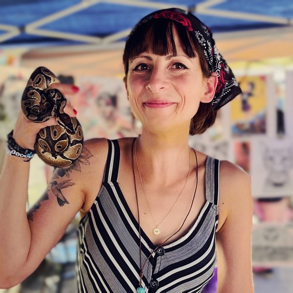
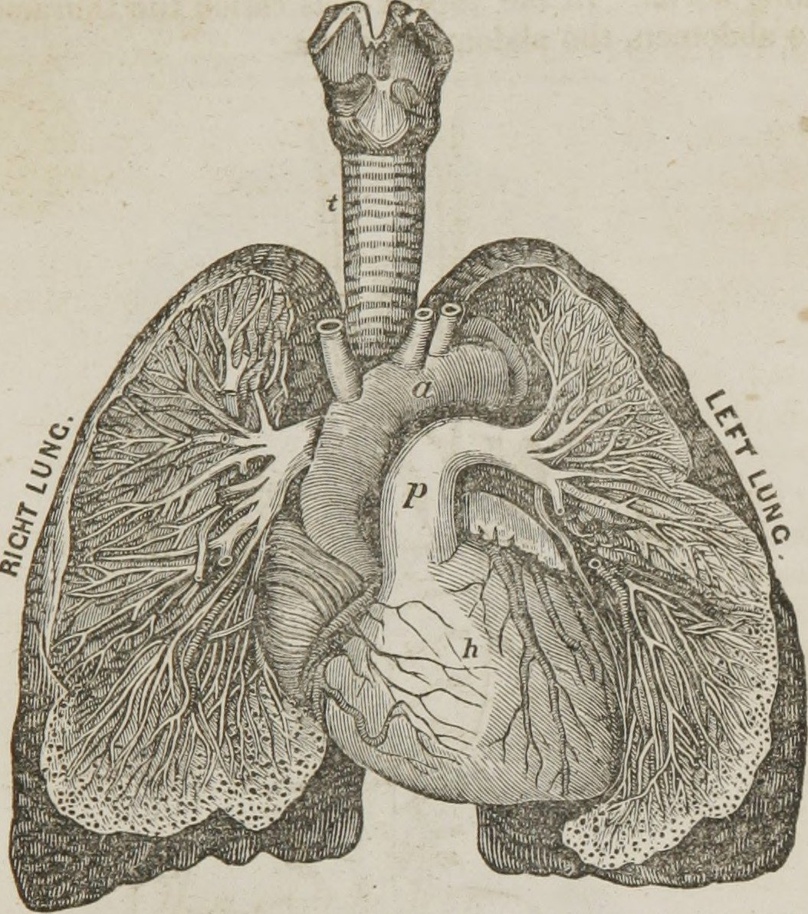
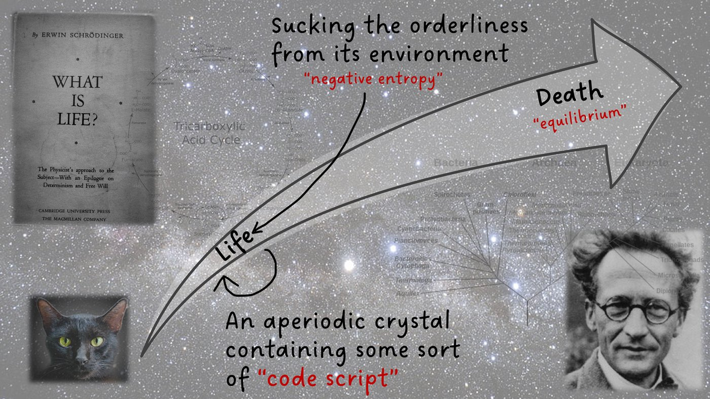
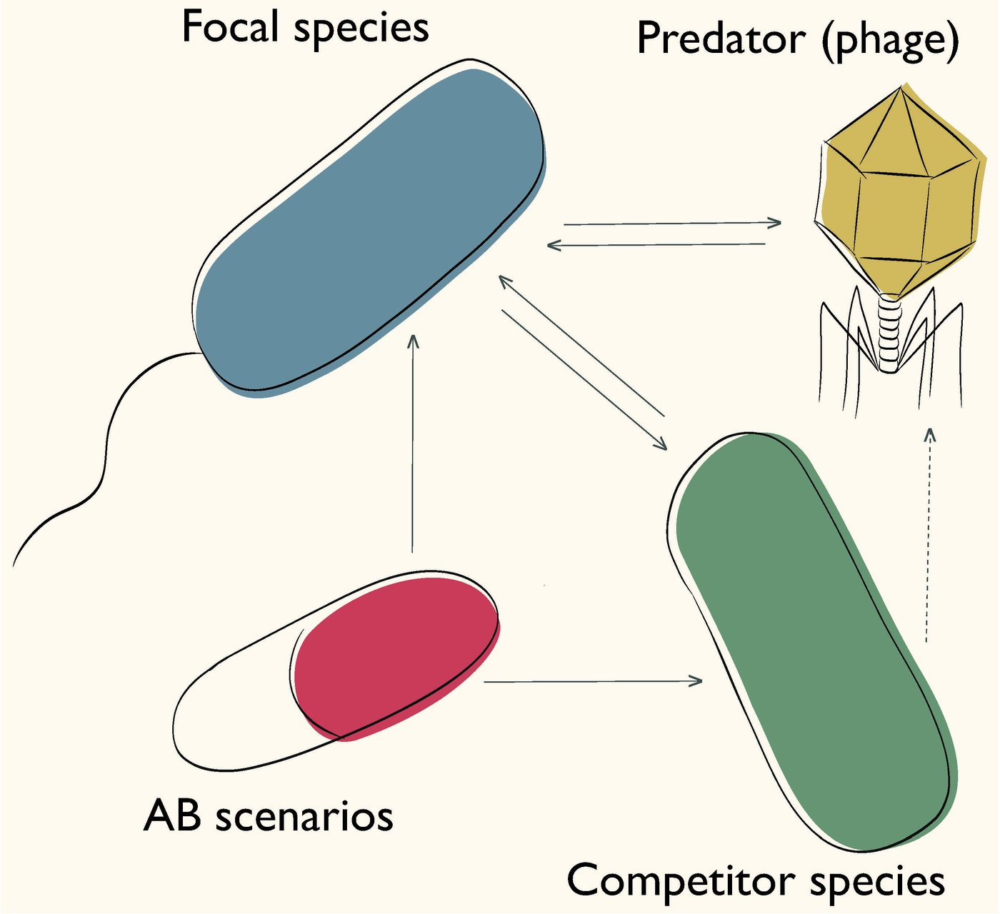
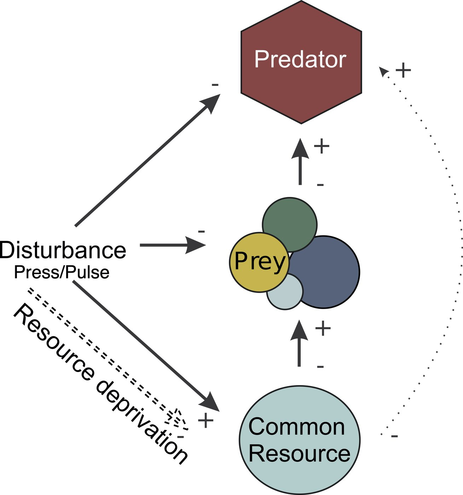

::::: {.hero}
:::: {.hero-text}
::: {.kicker}
Research Scholar · Georgia Institute of Technology
:::

# Canan Karakoç {.unnumbered}

::: {.role}
Evolutionary ecologist working with microbes. I combine experiments, data synthesis and eco-evolutionary theory to understand, and ultimately predict, how populations and communities persist and adapt as their environment changes.
:::

::: {.actions}
[<i class="bi bi-file-earmark-text"></i> CV (PDF)](media/CV.pdf){.btn-pill .solid target="_blank"}
[Publications](publications.qmd){.btn-pill}
[Contact](#contact){.btn-pill}
:::

::: {.social}
[<i class="bi bi-mortarboard"></i>Google Scholar](https://scholar.google.com/citations?user=BtBhIX4AAAAJ)
[<i class="bi bi-person-badge"></i>ORCID](https://orcid.org/0000-0002-3921-3535)
[<i class="bi bi-github"></i>GitHub](https://github.com/canankarakoc)
[<i class="bi bi-bluesky"></i>Bluesky](https://bsky.app/profile/ckarakoc.bsky.social)
[<i class="bi bi-linkedin"></i>LinkedIn](https://www.linkedin.com/in/canankarakoc666/)
:::
::::

:::: {.portrait}
{fig-alt="Portrait of Canan Karakoç" .nolightbox}
::::
:::::

## About me

I am a research scholar in [Sam Brown Lab](https://brownlab.biology.gatech.edu/) at the Georgia Institute of Technology. Previously, I worked with [Jay Lennon](https://lennonlab.github.io/) at Indiana University Bloomington, where I spent several years developing my research interests.

My work centers on eco-evolutionary dynamics—how communities persist, adapt, and maintain coexistence across space and time. I am particularly drawn to microbes (anything smaller than 1 mm): they offer a unique window into evolution unfolding in real time. By combining microbial systems with eco-evolutionary theory, I aim to understand—and ultimately predict—how environmental change shapes genes, populations, communities, and ecosystems.

I am currently supported by a [Cystic Fibrosis Foundation](https://www.cff.org/) Postdoctoral Fellowship, where I study the evolution of antibiotic resistance in *Pseudomonas aeruginosa*, a common pathogen in individuals with cystic fibrosis. More broadly, I am interested in how resistance evolution influences microbial community ecology, and how these insights can inform more effective treatment strategies.

Outside the lab, I enjoy drawing, illustrating, and doodling, often inspired by nature. I also spend time exploring philosophy of science, macro photography, crafting, and playing music.

## Research

::: {.topic-grid}
[{.nolightbox fig-alt=""}[Microbial dynamics, infections, and evolutionary medicine]{.topic-title}](research.qmd#infection){.topic-card}
[{.nolightbox fig-alt=""}[Life, energy limitation and dormancy]{.topic-title}](research.qmd#dormancy){.topic-card}
[{.nolightbox fig-alt=""}[Eco-evolutionary dynamics and trait evolution]{.topic-title}](research.qmd#ecoevo){.topic-card}
[{.nolightbox fig-alt=""}[Community dynamics and stability]{.topic-title}](research.qmd#community){.topic-card}
:::

## Recent publications

::: {#recent-pubs}
:::

[All publications](publications.qmd){.more-link}

## Illustrations

Nature-inspired drawings, mostly ink on paper.

::: {#art-strip}
:::

[See all illustrations](illustrations.qmd){.more-link}

## Contact {#contact}

Send me a message and I will get back to you. You can also find me on [Bluesky](https://bsky.app/profile/ckarakoc.bsky.social) and [Instagram](https://www.instagram.com/belovedblackram/).

```{=html}
<form name="contact" method="POST" action="thanks.html" data-netlify="true" netlify-honeypot="bot-field" class="contact-form">
  <input type="hidden" name="form-name" value="contact">
  <p class="hidden-field"><label>Leave this empty: <input name="bot-field"></label></p>
  <div><label for="cf-name">Name</label><input id="cf-name" type="text" name="name" autocomplete="name" required></div>
  <div><label for="cf-email">Email</label><input id="cf-email" type="email" name="email" autocomplete="email" required></div>
  <div class="full"><label for="cf-message">Message</label><textarea id="cf-message" name="message" rows="5" required></textarea></div>
  <button type="submit" class="btn-pill solid">Send message</button>
</form>
```
