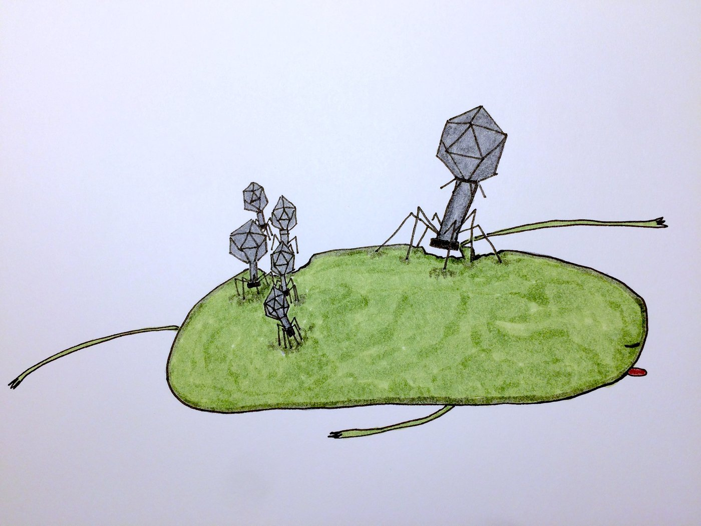
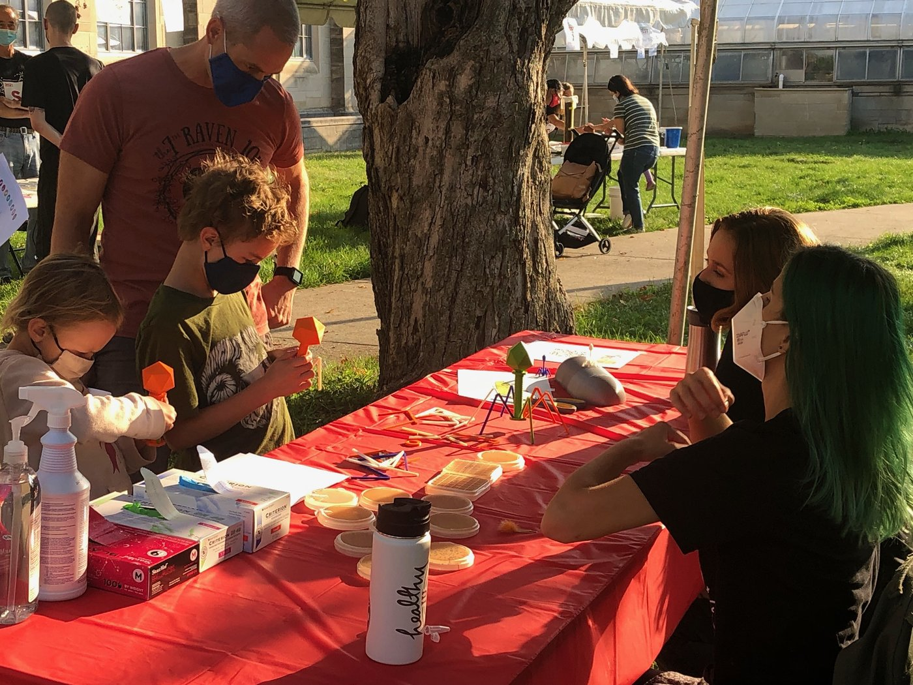
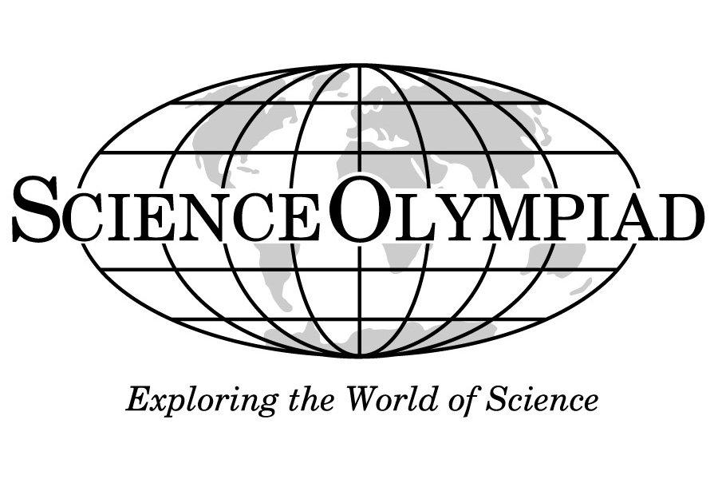
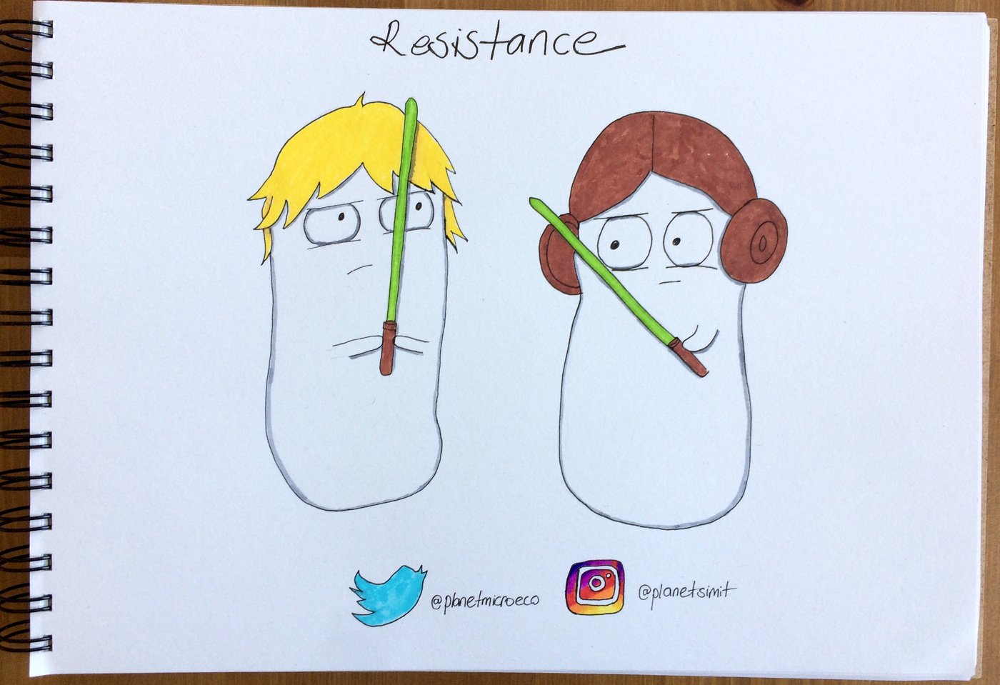

:::: {.feature #science-fest}
::: {.feature-img}
{fig-alt="Drawing of a bacteriophage on a bacterium"}
:::
::: {.feature-body}
## Science for public

In past years, I participated in [Science Fest](https://scienceoutreach.indiana.edu/news-events/science-fest/index.html) at IU. It is a public event encouraging the Bloomington community to come on campus and learn about research. Lennon Lab hosted a "Bacterial Viruses" table where we explained a bacteriophage infection using illustrations, 3D models, and lab samples.

{fig-alt="The Lennon Lab table at Science Fest"}
:::
::::

:::: {.feature #science-olympiad}
::: {.feature-img}
{fig-alt="Science Olympiad logo"}
:::
::: {.feature-body}
## Science Olympiad

I have mentored high school students for [Science Olympiad](https://www.soinc.org/) for the Experimental Design section at Bloomington South High School. Founded in 1984, the Science Olympiad is the premier team STEM competition in the nation, providing standards-based challenges to 6000 teams at 425 tournaments in all 50 states.
:::
::::

:::: {.feature #fun-science}
::: {.feature-img}
{fig-alt="Hand-drawn slide about antibiotic resistance"}
:::
::: {.feature-body}
## Fun science

Sometimes, it is difficult to tell about your science to scientists. I gave a fun, ignite talk on antibiotic resistance at iDiv Conference to a broad scientific audience.
:::
::::
