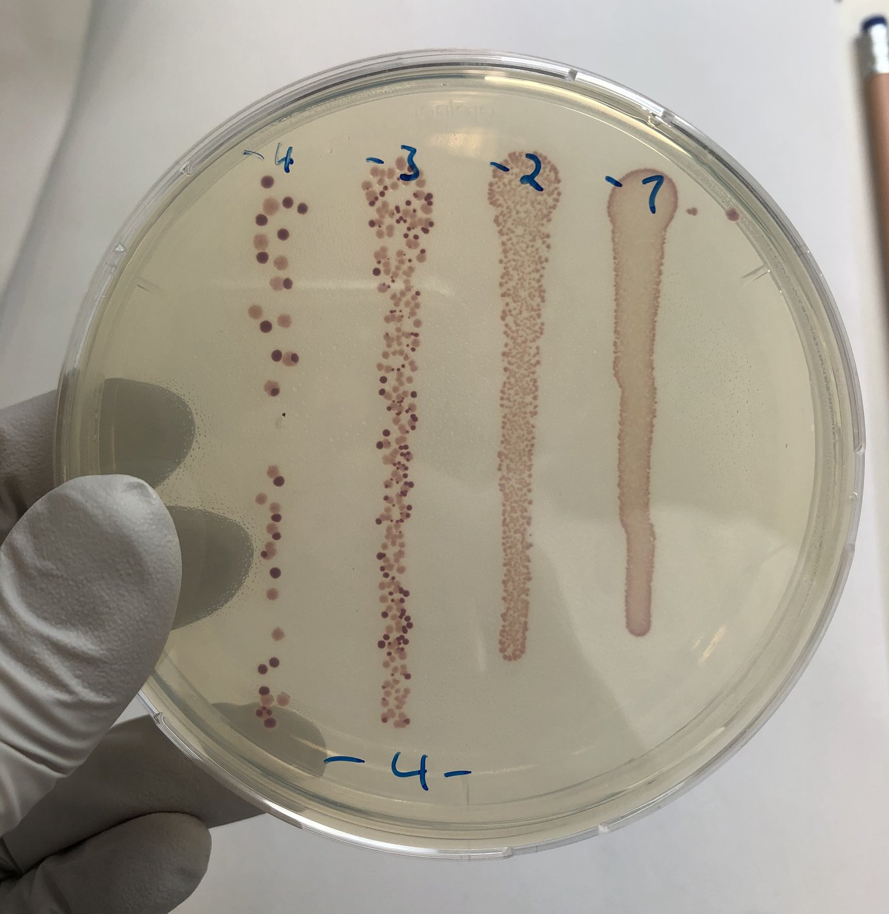
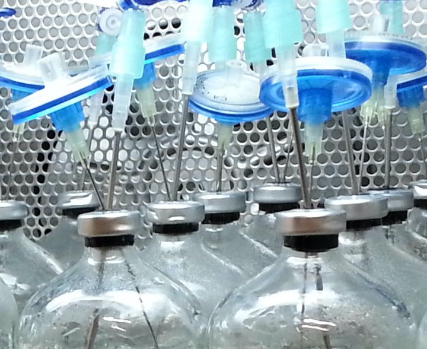
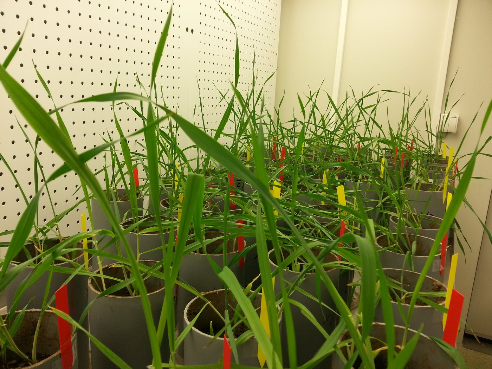

::: {.lead-text}
Much of microbial life is short of energy most of the time, in environments that change in ways that are hard to anticipate. I study how populations and communities persist and adapt under these conditions, with experiments in bacteria, phages, protists and the insect *Galleria mellonella*, genome sequencing, time-series analysis and theory.
:::

:::: {.feature #energy}
::: {.feature-img}
{fig-alt="Slide on Schrödinger's What is Life? and the arrow from life to death"}
:::
::: {.feature-body}
[]{#dormancy}

## Energy: what it costs to persist

When energy runs short, genetically identical cells do not all respond in the same way. Some keep growing, some form dormant spores, and some become persisters that survive antibiotics without being resistant. These states let a population survive stress, but they are not free.

With [Jay Lennon](https://lennonlab.github.io/), I measured the energetic cost of sporulation in *Bacillus subtilis* in units of ATP. Making and reviving a spore takes almost 10^10^ ATP, about 10% of a cell's total energy budget, so sporulation is favorable only when stress is long or unpredictable. When sporulation is not needed, its cost is large enough that selection can favor deleting sporulation genes rather than merely letting them decay. Related work follows *B. subtilis* populations through 1,000 days without added resources.

Next, I want to know what drives cells into each state and what that means for evolution. Dormant cells are not exposed to selection, so a large dormant fraction should slow adaptation.

**Paper:** [PNAS 2026](https://doi.org/10.1073/pnas.2524274123) · **Code:** [cost_of_spore](https://github.com/LennonLab/cost_of_spore) · [starvation](https://github.com/LennonLab/starvation)
:::
::::

:::: {.feature #predictability}
::: {.feature-img}
{fig-alt="Anatomical drawing of human lungs"}
:::
::: {.feature-body}
[]{#infection}

## Predictability: forecasting infection

Infections can end very differently in hosts that look alike at the start. In the [Brown Lab](https://brownlab.biology.gatech.edu/) I ask which measurements predict the outcome, and why some outcomes are hard to predict at all.

Across diverse host–pathogen systems, we found that the risk of death keeps rising over the course of an acute infection instead of staying constant, as standard epidemiological models assume. In the insect *Galleria mellonella* infected with *Pseudomonas aeruginosa*, the host's condition links infection history to survival: once host damage is accounted for, pathogen density adds little to predicting which hosts survive. In game-theory models of coevolution, hosts and pathogens that evolve conditional response rules, rather than fixed traits, accumulate cryptic genetic variation that is expressed abruptly once a threshold is crossed, and their responses to one another alone can make the dynamics hard to predict.

Next, I will manipulate host nutrition in *Galleria* to test whether energy limitation constrains how hosts respond to infection. Outside infection experiments, I ran the time-series analysis for a colleague's wastewater surveillance study, testing whether virus loads in sewage lead reported cases.

**Papers:** [mSphere 2025](https://doi.org/10.1128/msphere.00953-24) · *Proceedings B* (under review) · **Code:** [Galleria_Survival](https://github.com/GaTechBrownLab/Galleria_Survival) · [GoldsteinGameTheory](https://github.com/GaTechBrownLab/GoldsteinGameTheory) · [wasteWaterVirus](https://github.com/canankarakoc/wasteWaterVirus)
:::
::::

:::: {.feature #noise}
::: {.feature-img}
{fig-alt="Diagram of a focal bacterial species with a phage predator, a competitor species and antibiotic scenarios"}
:::
::: {.feature-body}
[]{#ecoevo}

## Noise: fluctuating environments and noisy data

Environments with the same average conditions can differ in how predictable their fluctuations are. Theory predicts that this alone changes what evolves: predictable change should favor genetic adaptation, and unpredictable change flexible strategies such as bet-hedging. The prediction is rarely tested with the mean and variance held fixed.

In ongoing experiments, *Escherichia coli* evolves with its phages and competitors under antibiotic regimes that differ only in how they fluctuate over time, and I measure how growth, resistance and phage susceptibility change. In a pilot I designed at UFZ with two students, the strain evolved its highest resistance only without competitors, and the competitor it faced shaped which traits evolved.

{fig-alt="Bacterial colonies streaked on an agar plate" width="70%"}

Noise is also a property of data. As PI of a [Cystic Fibrosis Foundation](https://www.cff.org/) fellowship, I analyze longitudinal records of routine antibiotic-susceptibility tests of *P. aeruginosa* from people with cystic fibrosis, treating each test as a noisy sample of the resistance in the patient. Bayesian mixed models, Markov models of transitions between resistance states and empirical dynamic modeling indicate that resistance follows nonlinear, state-dependent dynamics.

Across projects, I use empirical dynamic modeling to measure predictability and infer causal links from time series, and state-space models to separate real fluctuations from measurement error ([Ecosphere 2022](https://doi.org/10.1002/ecs2.4328)).
:::
::::

:::: {.feature #community}
::: {.feature-img}
{fig-alt="Diagram of a predator, prey species and a common resource under disturbance"}
:::
::: {.feature-body}
## Community dynamics and stability

My PhD at [UFZ](https://www.ufz.de/index.php?en=33573) and [iDiv](https://www.idiv.de/en/index.html) asked how predator–prey interactions shape communities under disturbance, using microcosms of bacterial prey and the protist predator *Tetrahymena*. I examined how the system recovers from press and pulse disturbances and how predation and disturbance together shape prey communities, and showed that interaction strengths shift over time in ways that alter which species coexist.

Since then, with colleagues, I have helped develop ways to measure stability in systems without static equilibria and a practical guide to characterizing coexistence, and tested how temperature and biodiversity relate to the stability of natural aquatic food webs. I have also worked in more natural settings: freshwater microbial communities under nutrient enrichment, a field experiment on climate extremes in grassland and heath, and greenhouse experiments in which drought changed how mycorrhizal fungal diversity and barley genotype diversity interact. For colleagues at UFZ, I reanalyzed experiments on plasmid transfer between bacteria along fungal hyphae.

These projects share a question I now ask across levels of organization: when the parts of a system respond differently to change, does that response diversity keep the whole stable?

::: {layout-ncol="2"}
{fig-alt="Microcosm bottles in an incubator"}

{fig-alt="Barley pots in a greenhouse"}
:::

**Papers:** [BMC Ecology 2017](https://doi.org/10.1186/s12898-017-0123-2) · [Scientific Reports 2018](https://doi.org/10.1038/s41598-018-21219-x) · [Scientific Reports 2019](https://doi.org/10.1038/s41598-019-45702-1) · [Ecology Letters 2020](https://doi.org/10.1111/ele.13500) · [Ecology Letters 2021](https://doi.org/10.1111/ele.13760) · [Ecosphere 2022](https://doi.org/10.1002/ecs2.4328) · [Nature Communications 2023](https://doi.org/10.1038/s41467-023-38977-6) · [Biological Reviews 2026](https://doi.org/10.1111/brv.70079) · **Code:** [fungal-highways-reanalysis](https://github.com/canankarakoc/fungal-highways-reanalysis)
:::
::::
